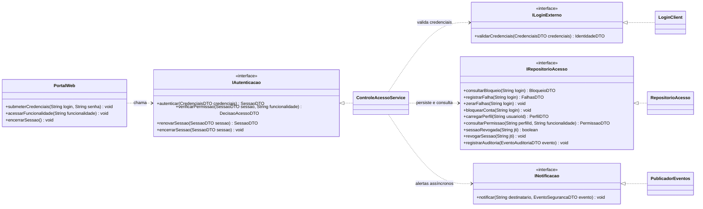
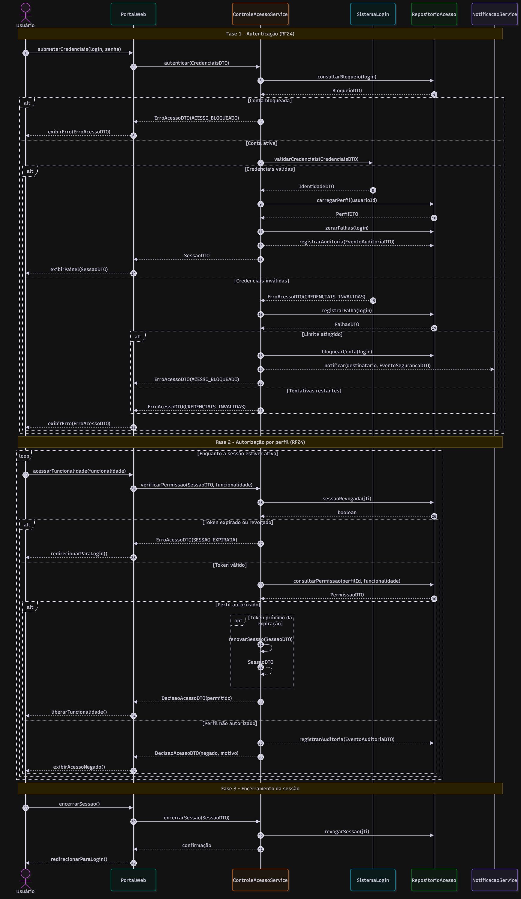
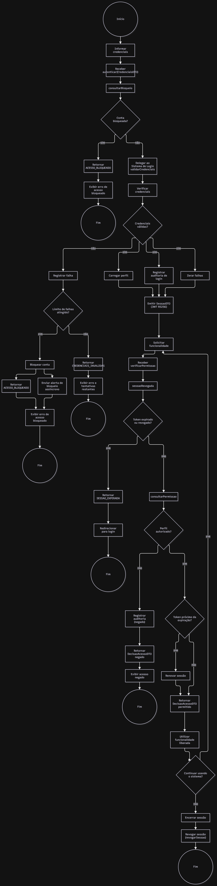
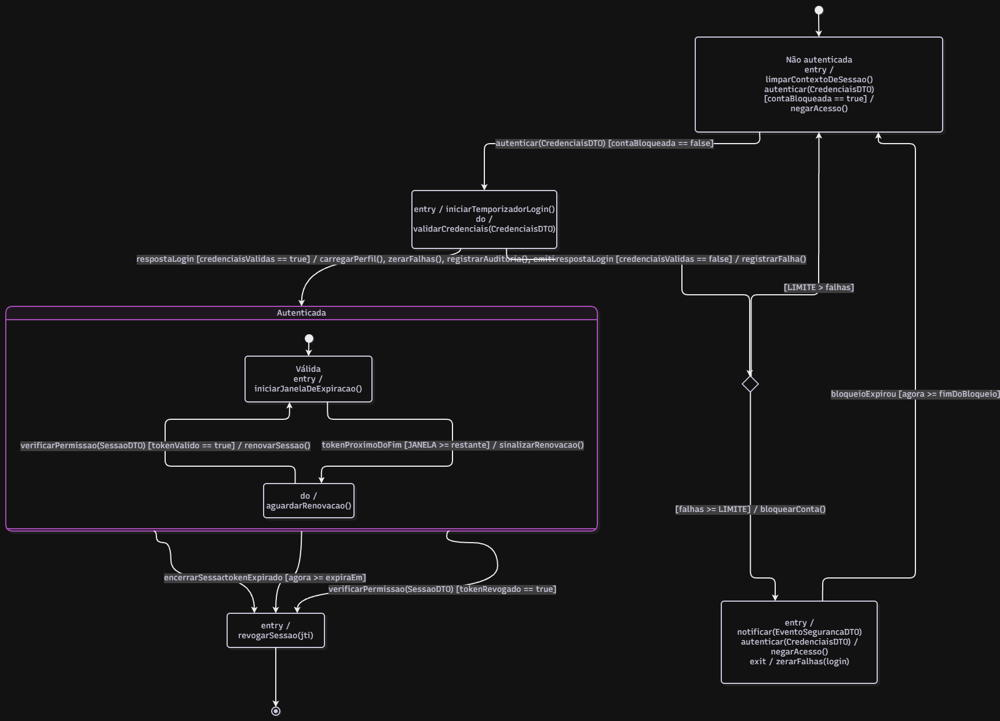
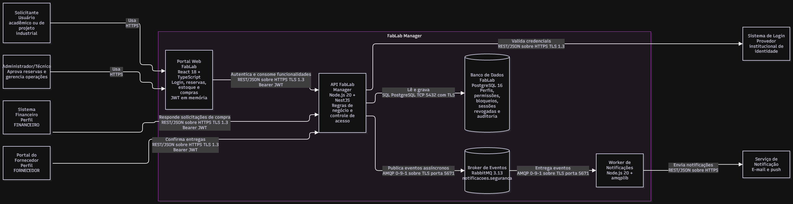

# Dossiê de Arquitetura Viva — FabLab Manager: Controle de Acesso

**Unidade Curricular:** Modelagem de Software · **Curso:** Engenharia de Software (4º Período — UniSenai) · **Docente:** Prof. Sidney L. da Silva
**Atividade:** APS 3 — Modelagem Comportamental as-Code (individual)
**Aluno(a):** Nicolas Vieira Marques

---

## 1. Funcionalidade crítica escolhida

**Componente Controle de Acesso (RF24)** do projeto FabLab Manager: autenticação do usuário perante o Sistema de Login externo e autorização de cada funcionalidade conforme o perfil (regra de negócio 13).

**Por que é de alta criticidade:** todas as demais funcionalidades (reservar máquina, aprovar reserva, reordenar fila, aprovar compra, confirmar entrega) dependem dessa decisão. Uma falha aqui permite, por exemplo, que um Solicitante aprove a própria reserva ou que um perfil sem alçada aprove uma compra.

**Perfis e permissões** (derivados do backlog RF01–RF25):

| Perfil | Funcionalidades permitidas |
|---|---|
| SOLICITANTE | RF01, RF02, RF05, RF09, RF15 |
| ADMIN_TECNICO | RF06, RF07, RF08, RF10, RF11, RF12, RF14, RF16, RF18 |
| FINANCEIRO | RF19, RF20 |
| FORNECEDOR | RF22 |

Solicitante e Administrador/Técnico usam o Portal Web. Financeiro e Fornecedor correspondem ao Sistema Financeiro e ao Portal do Fornecedor, sistemas externos do modelo da equipe que se integram pela API. As demais funcionalidades (RF03, RF04, RF13, RF17, RF21, RF23, RF25) são executadas pelo próprio sistema e não são expostas a perfis.

**Regras de comportamento adotadas** (usadas de forma idêntica em todos os artefatos):

- `LIMITE` = 3 falhas consecutivas de login bloqueiam a conta; o bloqueio expira sozinho após 15 minutos.
- Token JWT RS256 com validade de 15 minutos; é renovado quando restarem no máximo `JANELA` = 2 minutos e a sessão ainda estiver em uso.
- Logout e invalidação revogam o `jti` do token.
- O alerta de segurança é enviado de forma **assíncrona**; a auditoria não bloqueia a resposta.

---

## 2. Contrato de interfaces e DTOs

Base da **regra de consistência** do Artefato 1: toda mensagem do diagrama de sequência corresponde a uma operação pública declarada abaixo.



**DTOs**

| DTO | Campos |
|---|---|
| `CredenciaisDTO` | login, senha |
| `IdentidadeDTO` | usuarioId, nome |
| `PerfilDTO` | perfilId, nome |
| `SessaoDTO` | token, jti, perfilId, expiraEm |
| `BloqueioDTO` | bloqueada, desbloqueioEm |
| `FalhasDTO` | total |
| `PermissaoDTO` | permitido |
| `DecisaoAcessoDTO` | permitido, motivo |
| `ErroAcessoDTO` | codigo (`ACESSO_BLOQUEADO`, `CREDENCIAIS_INVALIDAS`, `SESSAO_EXPIRADA`), mensagem |
| `EventoSegurancaDTO` | tipo, usuarioId, ocorridoEm |
| `EventoAuditoriaDTO` | tipo, usuarioId, funcionalidade, ocorridoEm |

**Linhas de vida × contratos × componentes C4**

| Linha de vida (sequência) | Contrato | Componente C4 |
|---|---|---|
| `U` Usuário | — (ator) | Solicitante e Administrador/Técnico (pessoas); Sistema Financeiro e Portal do Fornecedor (sistemas externos) |
| `W` PortalWeb | `PortalWeb` | Portal Web FabLab (React) e, na API, `AuthController` / `PermissaoGuard` |
| `A` ControleAcessoService | `IAutenticacao` | `ControleAcessoService` |
| `L` SistemaLogin | `ILoginExterno` | Sistema de Login (externo), acessado via `LoginClient` |
| `R` RepositorioAcesso | `IRepositorioAcesso` | `RepositorioAcesso` → PostgreSQL 16 |
| `N` NotificacaoService | `INotificacao` | `PublicadorEventos` → RabbitMQ → Worker → Serviço de Notificação |

---

## 3. Artefato 1 — Diagrama de Sequência



- Chamadas **síncronas** (`->>`) entre Portal, Controle de Acesso, Login e Repositório; chamadas **assíncronas** (`-)`) para o alerta de bloqueio e para a auditoria.
- Fragmentos combinados: `alt/else` aninhados (conta bloqueada, credenciais, limite de falhas, token, perfil), `opt` (renovação do token) e `loop` (requisições enquanto a sessão estiver ativa).
- Retornos tipados com DTOs (`SessaoDTO`, `BloqueioDTO`, `PermissaoDTO`, `DecisaoAcessoDTO`, `ErroAcessoDTO`...).

<details>
<summary>Código-fonte (Mermaid) — <code>docs/diagrams/sequencia.mmd</code></summary>

```text
sequenceDiagram
autonumber
actor U as Usuário
participant W as PortalWeb
participant A as ControleAcessoService
participant L as SistemaLogin
participant R as RepositorioAcesso
participant N as NotificacaoService

Note over U,N: Fase 1 - Autenticação (RF24)
U->>W: submeterCredenciais(login, senha)
W->>A: autenticar(CredenciaisDTO)
A->>R: consultarBloqueio(login)
R-->>A: BloqueioDTO

alt Conta bloqueada (BloqueioDTO.bloqueada == true)
    A-->>W: ErroAcessoDTO(ACESSO_BLOQUEADO)
    W-->>U: exibirErro(ErroAcessoDTO)
else Conta ativa
    A->>L: validarCredenciais(CredenciaisDTO)
    alt Credenciais válidas
        L-->>A: IdentidadeDTO
        A->>R: carregarPerfil(usuarioId)
        R-->>A: PerfilDTO
        A->>R: zerarFalhas(login)
        A-)R: registrarAuditoria(EventoAuditoriaDTO)
        A-->>W: SessaoDTO
        W-->>U: exibirPainel(SessaoDTO)
    else Credenciais inválidas
        L-->>A: ErroAcessoDTO(CREDENCIAIS_INVALIDAS)
        A->>R: registrarFalha(login)
        R-->>A: FalhasDTO
        alt Limite atingido (FalhasDTO.total >= LIMITE)
            A->>R: bloquearConta(login)
            A-)N: notificar(destinatario, EventoSegurancaDTO)
            A-->>W: ErroAcessoDTO(ACESSO_BLOQUEADO)
        else Tentativas restantes
            A-->>W: ErroAcessoDTO(CREDENCIAIS_INVALIDAS)
        end
        W-->>U: exibirErro(ErroAcessoDTO)
    end
end

Note over U,N: Fase 2 - Autorização por perfil (RF24)
loop Enquanto a sessão estiver ativa
    U->>W: acessarFuncionalidade(funcionalidade)
    W->>A: verificarPermissao(SessaoDTO, funcionalidade)
    A->>R: sessaoRevogada(jti)
    R-->>A: boolean
    alt Token expirado ou revogado
        A-->>W: ErroAcessoDTO(SESSAO_EXPIRADA)
        W-->>U: redirecionarParaLogin()
    else Token válido
        A->>R: consultarPermissao(perfilId, funcionalidade)
        R-->>A: PermissaoDTO
        alt Perfil autorizado (PermissaoDTO.permitido == true)
            opt Token próximo da expiração
                A->>A: renovarSessao(SessaoDTO)
                A-->>A: SessaoDTO
            end
            A-->>W: DecisaoAcessoDTO(permitido)
            W-->>U: liberarFuncionalidade()
        else Perfil não autorizado
            A-)R: registrarAuditoria(EventoAuditoriaDTO)
            A-->>W: DecisaoAcessoDTO(negado, motivo)
            W-->>U: exibirAcessoNegado()
        end
    end
end

Note over U,N: Fase 3 - Encerramento da sessão
U->>W: encerrarSessao()
W->>A: encerrarSessao(SessaoDTO)
A->>R: revogarSessao(jti)
A-->>W: confirmação (void)
W-->>U: redirecionarParaLogin()
```

</details>

---

## 4. Artefato 2 — Diagrama de Atividades com Raias



- **4 raias:** Usuário (ator), Controle de Acesso (back-end), Sistema de Login (serviço externo) e Serviço de Notificação (serviço externo).
- **Condições de guarda** booleanas e mutuamente exclusivas em todas as decisões (por exemplo `[contaBloqueada == true]` / `[contaBloqueada == false]`).
- **Concorrência:** *Fork/Join* na emissão da sessão (carregar perfil, registrar auditoria e zerar falhas em paralelo) e *Fork/Join* no bloqueio (alerta de segurança em paralelo à resposta de acesso bloqueado).
- Os nós usam os nomes das operações do contrato (`consultarBloqueio`, `registrarFalha`, `sessaoRevogada`, `renovarSessao`...).

> O Mermaid não possui raias nativas: elas são representadas por `subgraph`. A posição das raias na imagem é definida pelo motor de layout.

<details>
<summary>Código-fonte (Mermaid) — <code>docs/diagrams/atividades.mmd</code></summary>

```text
flowchart TD
    subgraph USR["Raia 1 - Usuário (Ator)"]
        A(["Início"])
        B["Informar credenciais"]
        U1["Exibir erro de acesso bloqueado"]
        U1b["Exibir erro e tentativas restantes"]
        U2["Solicitar funcionalidade"]
        U3["Utilizar funcionalidade liberada"]
        D7{"Continuar usando o sistema?"}
        U6["Encerrar sessão"]
        U4["Exibir acesso negado"]
        U5["Redirecionar para login"]
        FIM1(((Fim)))
        FIM3(((Fim)))
        FIM4(((Fim)))
    end

    subgraph ACES["Raia 2 - Controle de Acesso (Back-end)"]
        C1["Receber autenticar(CredenciaisDTO)"]
        D1{"Conta bloqueada? (consultarBloqueio)"}
        C2["Negar acesso: ACESSO_BLOQUEADO"]
        C2b["Retornar ACESSO_BLOQUEADO"]
        C3["Delegar ao Sistema de Login (validarCredenciais)"]
        D2{"Credenciais válidas?"}
        C4["Registrar falha (registrarFalha)"]
        D3{"Limite de falhas atingido?"}
        C5["Bloquear conta (bloquearConta)"]
        C6["Retornar CREDENCIAIS_INVALIDAS"]
        F1@{ shape: fork, label: "Fork" }
        C7["Carregar perfil (carregarPerfil)"]
        C8["Registrar auditoria de login (registrarAuditoria)"]
        C9["Zerar falhas (zerarFalhas)"]
        J1@{ shape: fork, label: "Join" }
        C10["Emitir SessaoDTO (JWT RS256, 15 min)"]
        C11["Receber verificarPermissao(SessaoDTO, funcionalidade)"]
        D4{"Token expirado ou revogado? (sessaoRevogada)"}
        D5{"Perfil autorizado? (consultarPermissao)"}
        D6{"Token próximo da expiração?"}
        C16["Renovar sessão (renovarSessao)"]
        C12["Retornar DecisaoAcessoDTO permitido"]
        C13["Registrar auditoria de acesso negado (registrarAuditoria)"]
        C14["Retornar DecisaoAcessoDTO negado"]
        C15["Retornar SESSAO_EXPIRADA"]
        C17["Receber encerrarSessao(SessaoDTO) e revogar (revogarSessao)"]
        F2@{ shape: fork, label: "Fork" }
        J2@{ shape: fork, label: "Join" }
    end

    subgraph EXT["Raia 3 - Sistema de Login (Serviço Externo)"]
        L1["Verificar credenciais"]
    end

    subgraph NOT["Raia 4 - Serviço de Notificação (Serviço Externo)"]
        N1["Enviar alerta de bloqueio (notificar, assíncrono)"]
    end

    %% Autenticação
    A --> B --> C1 --> D1
    D1 -- "[contaBloqueada == true]" --> C2 --> U1
    D1 -- "[contaBloqueada == false]" --> C3
    C3 --> L1 --> D2
    D2 -- "[credenciaisValidas == false]" --> C4 --> D3
    D3 -- "[falhas >= LIMITE]" --> C5 --> F2
    F2 --> N1 --> J2
    F2 --> C2b --> J2
    J2 --> U1
    U1 --> FIM1
    D3 -- "[LIMITE > falhas]" --> C6 --> U1b --> B

    %% Emissão de sessão (concorrência)
    D2 -- "[credenciaisValidas == true]" --> F1
    F1 --> C7 --> J1
    F1 --> C8 --> J1
    F1 --> C9 --> J1
    J1 --> C10 --> U2 --> C11 --> D4

    %% Autorização
    D4 -- "[tokenExpiradoOuRevogado == true]" --> C15 --> U5 --> B
    D4 -- "[tokenExpiradoOuRevogado == false]" --> D5
    D5 -- "[perfilAutorizado == true]" --> D6
    D6 -- "[tokenProximoDoFim == true]" --> C16 --> C12
    D6 -- "[tokenProximoDoFim == false]" --> C12
    C12 --> U3 --> D7
    D5 -- "[perfilAutorizado == false]" --> C13 --> C14 --> U4 --> FIM4

    %% Uso contínuo e encerramento
    D7 -- "[continuarUsando == true]" --> U2
    D7 -- "[continuarUsando == false]" --> U6 --> C17 --> FIM3
```

</details>

---

## 5. Artefato 3 — Diagrama de Transição de Estados



Entidade principal: **Sessão de Acesso** (`stateDiagram-v2`).

- Estado inicial `[*]` e estado terminal `Encerrada` → `[*]`.
- **Subestados:** `Autenticada` contém `Válida` e `Expirando`.
- Transições no formato **Gatilho [Condição] / Ação**; a apuração do limite de falhas usa um pseudoestado de decisão (`choice`), avaliado depois de `registrarFalha()`.
- Ações internas `entry`, `do` e `exit` em `Autenticando`, `Bloqueada`, `Válida`, `Expirando`, `Encerrada` e `NaoAutenticada`.
- Tentativa de login com conta bloqueada é uma **transição interna** (`autenticar [...] / negarAcesso()`): não sai nem reentra no estado, então o alerta de `entry / notificar(...)` não se repete a cada tentativa.
- As variáveis das guardas vêm de consultas da sequência, avaliadas antes da guarda: `contaBloqueada` ← `consultarBloqueio(login)` e `tokenRevogado` ← `sessaoRevogada(jti)`. `consultarPermissao` não altera o estado da sessão, por isso não aparece na máquina de estados.

<details>
<summary>Código-fonte (Mermaid) — <code>docs/diagrams/estados.mmd</code></summary>

```text
stateDiagram-v2
    direction TB

    state "Não autenticada" as NaoAutenticada
    state "Autenticando" as Autenticando
    state "Bloqueada" as Bloqueada
    state "Encerrada" as Encerrada
    state apurar <<choice>>
    state "Autenticada" as Autenticada {
        [*] --> Valida
        state "Válida" as Valida
        state "Expirando" as Expirando
        Valida --> Expirando : tokenProximoDoFim [JANELA >= restante] / sinalizarRenovacao()
        Expirando --> Valida : verificarPermissao(SessaoDTO) [tokenValido == true] / renovarSessao()
    }

    [*] --> NaoAutenticada
    NaoAutenticada --> Autenticando : autenticar(CredenciaisDTO) [contaBloqueada == false]
    Autenticando --> Autenticada : respostaLogin [credenciaisValidas == true] / carregarPerfil(), zerarFalhas(), registrarAuditoria(), emitirSessao()
    Autenticando --> apurar : respostaLogin [credenciaisValidas == false] / registrarFalha()
    apurar --> Bloqueada : [falhas >= LIMITE] / bloquearConta()
    apurar --> NaoAutenticada : [LIMITE > falhas]
    Bloqueada --> NaoAutenticada : bloqueioExpirou [agora >= fimDoBloqueio]
    Autenticada --> Encerrada : encerrarSessao()
    Autenticada --> Encerrada : tokenExpirado [agora >= expiraEm]
    Autenticada --> Encerrada : verificarPermissao(SessaoDTO) [tokenRevogado == true]
    Encerrada --> [*]

    NaoAutenticada : entry / limparContextoDeSessao()
    NaoAutenticada : autenticar(CredenciaisDTO) [contaBloqueada == true] / negarAcesso()

    Autenticando : entry / iniciarTemporizadorLogin()
    Autenticando : do / validarCredenciais(CredenciaisDTO)

    Bloqueada : entry / notificar(EventoSegurancaDTO)
    Bloqueada : autenticar(CredenciaisDTO) / negarAcesso()
    Bloqueada : exit / zerarFalhas(login)

    Valida : entry / iniciarJanelaDeExpiracao()
    Expirando : do / aguardarRenovacao()

    Encerrada : entry / revogarSessao(jti)
```

</details>

---

## 6. Artefato 4 — Visão Arquitetural C4

Código-fonte: [`docs/architecture/workspace.puml`](docs/architecture/workspace.puml) (C4-PlantUML: Visão de Contêineres).

Tecnologias: React 18, Node.js 20 + NestJS, PostgreSQL 16, RabbitMQ 3.13. Protocolos explícitos nos conectores: REST/JSON sobre HTTPS (TLS 1.3), SQL sobre TCP 5432 com TLS e AMQP 0-9-1 sobre TLS.



---

## 7. Artefato 5 — Registro de Decisão Arquitetural

[`docs/architecture/adr-0001.md`](docs/architecture/adr-0001.md) — **ADR 0001: Autorização RBAC com JWT de curta duração no Controle de Acesso** (Status: Proposto), no formato Nygard (Título, Status, Contexto, Decisão, Consequências).

---

## 8. Matriz de consistência entre os modelos

| Conceito | Sequência | Atividades | Estados | C4 / ADR |
|---|---|---|---|---|
| Bloqueio por `LIMITE` falhas | `alt` Limite atingido → `bloquearConta` | `[falhas >= LIMITE]` → Bloquear conta | `choice` → `Bloqueada` | ADR, decisão 5 |
| Alerta de segurança assíncrono | `A-)N: notificar(...)` | *Fork* → Enviar alerta (raia Notificação) | `Bloqueada`: `entry / notificar(...)` | `PublicadorEventos` → RabbitMQ (AMQP/TLS) |
| Login válido | `carregarPerfil`, `zerarFalhas`, `registrarAuditoria`, `SessaoDTO` | *Fork/Join* (3 tarefas) → Emitir `SessaoDTO` | `Autenticando → Autenticada` com os mesmos efeitos | ADR, decisões 1 e 2 |
| Token de 15 min e renovação | `opt` Token próximo da expiração → `renovarSessao` | `[tokenProximoDoFim]` → Renovar sessão | `Válida ⇄ Expirando` | ADR, decisão 2 |
| Revogação / logout | `sessaoRevogada(jti)`, `revogarSessao(jti)` | `[tokenExpiradoOuRevogado]`, Encerrar sessão | `Encerrada`: `entry / revogarSessao(jti)` | Lista de revogados no PostgreSQL |
| Autorização por perfil | `consultarPermissao` → `DecisaoAcessoDTO` | `[perfilAutorizado]` | — | `PermissaoGuard` + matriz perfil × funcionalidade |
| Conta bloqueada tenta login | `alt` Conta bloqueada → `ACESSO_BLOQUEADO` | `[contaBloqueada == true]` | Transição interna `negarAcesso()` | `ControleAcessoService` |

---

## 9. Invariantes (proteção contra estados inválidos)

- Uma sessão só é emitida a partir de `Autenticando` com `credenciaisValidas == true`; nenhum outro caminho leva a `Autenticada`.
- Conta bloqueada nunca chega a `Autenticando`: a guarda `[contaBloqueada == false]` impede a chamada ao Sistema de Login.
- `Encerrada` é terminal: um token revogado ou expirado nunca volta a `Autenticada`, e uma nova autenticação cria nova sessão em `NaoAutenticada`.
- Toda funcionalidade protegida passa por `verificarPermissao`; sem decisão `permitido`, a funcionalidade não é liberada.
- Falhas são contadas a cada resposta inválida e zeradas apenas por login válido ou pelo fim do bloqueio.

---

## 10. Estrutura do repositório

```
aps3-nome-sobrenome/
├── docs/
│   ├── architecture/
│   │   ├── workspace.puml     <-- C4 (PlantUML): Contêineres
│   │   └── adr-0001.md        <-- Registro de Decisão Arquitetural
│   └── diagrams/
│       ├── sequencia.mmd      <-- Diagrama de Sequência
│       ├── atividades.mmd     <-- Diagrama de Atividades
│       └── estados.mmd        <-- Diagrama de Transição de Estados
├── assets/                    <-- Imagens renderizadas dos diagramas (usadas neste README)
│   ├── sequencia.png
│   ├── atividades.png
│   ├── estados.png
│   └── c4-containers.png
└── README.md
```

**Como regenerar as imagens**

- Mermaid: `npx @mermaid-js/mermaid-cli -i docs/diagrams/sequencia.mmd -o assets/sequencia.png` (idem para `atividades` e `estados`).
- C4-PlantUML: `java -jar plantuml.jar -tpng -o ../../assets docs/architecture/workspace.puml` (executado de dentro de docs/architecture/ gerando a visão de contêineres).

---

## 11. Declaração de autoria

Declaro que este dossiê foi elaborado individualmente por _[NOME COMPLETO]_ para a APS 3 de Modelagem de Software e que sou capaz de explicar e defender cada decisão de modelagem aqui registrada. O histórico de commits do repositório reflete a evolução do trabalho.